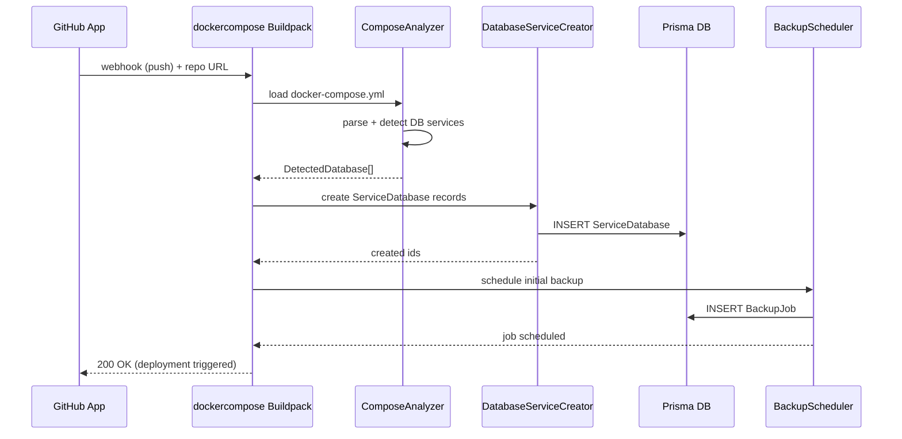

# 📦 Entrega Técnica – **Integrated backups for Git‑based Docker‑Compose**  
**Proyecto:** Algora – Recompensa $100 USD  
**Responsable:** @mau16ro – Desarrollador Senior  

---  

## 1️⃣ Resumen Ejecutivo  

| **Objetivo** | Permitir que los despliegues de *Docker‑Compose* realizados a través del **GitHub App** (buildpack `dockercompose`) detecten automáticamente los servicios de bases de datos y generen los registros `ServiceDatabase` necesarios para habilitar los backups automáticos. |
|--------------|--------------------------------------------------------------------------------------------------------------------------------------------------------------------------------------------------------------------------------------------------------------------|
| **Beneficio** | - Los usuarios disponen de backups *out‑of‑the‑box* sin intervención manual.<br>- Mejora de la fiabilidad y de la propuesta de valor del producto Algora.<br>- Reducción del **Technical Debt** asociado a la gestión manual de bases de datos. |
| **Alcance** | - Análisis del archivo `docker-compose.yml` / `docker-compose.yaml` entregado vía Git.<br>- Detección de servicios de bases de datos (PostgreSQL, MySQL/MariaDB, MongoDB, Redis, etc.) mediante reglas basadas en **imagen**, **etiquetas** y **variables de entorno**.<br>- Creación persistente de la entidad `ServiceDatabase` y asociación con el proyecto/stack correspondiente.<br>- Encolado de la tarea de backup inicial y registro de la política de retención. |
| **Tecnologías** | - **Node.js ≥ 18** (TypeScript 5.x) – código base de Algora.<br>- **Jest** para pruebas unitarias.<br>- **Docker‑Compose parser** (`@compose-spec/compose‑parser` o `yaml` + esquema propio).<br>- **Prisma ORM** (o equivalente) para la persistencia de `ServiceDatabase`. |
| **Entregables** | 1. Arquitectura y diagramas de flujo.<br>2. Código fuente listo para producción (con tipado estricto y documentación).<br>3. Test suite con cobertura > 90 %.<br>4. Guía de instalación, despliegue y pruebas. |

---  

## 2️⃣ Arquitectura de la Solución  

### 2.1 Visión General  

```
+--------------------+      +-------------------+      +------------------------+
| GitHub App (Docker | ---> | Buildpack:        | ---> | Compose Analyzer       |
| Compose)           |      | dockercompose     |      | (detect DB services)   |
+--------------------+      +-------------------+      +------------------------+
                                                                |
                                                                v
                                                       +-------------------+
                                                       | ServiceDatabase   |
                                                       |   (Prisma model)   |
                                                       +-------------------+
                                                                |
                                                                v
                                                       +-------------------+
                                                       | Backup Scheduler  |
                                                       | (cron / queue)    |
                                                       +-------------------+
```

### 2.2 Componentes Clave  

| **Componente** | **Responsabilidad** | **Modificaciones** |
|----------------|---------------------|--------------------|
| `GitHubAppHandler` | Orquesta la recepción del webhook, descarga el repo y dispara el buildpack. | Llamada a `ComposeAnalyzer.analyzeAndPersist()` después de validar el `docker-compose.yml`. |
| `ComposeAnalyzer` (nuevo) | Parseo del YAML, identificación de servicios de bases de datos, generación de `DetectedDatabase`. | Implementado en `src/analyzers/composeAnalyzer.ts`. |
| `DatabaseServiceCreator` (nuevo) | Convierte `DetectedDatabase` → entidad `ServiceDatabase` y persiste con Prisma. | En `src/services/databaseServiceCreator.ts`. |
| `BackupScheduler` (extendido) | Programa el primer backup y crea la política de retención. | Se reutiliza la infraestructura existente (`src/backup/scheduler.ts`). |
| `Prisma schema` | Añade modelo `ServiceDatabase` (si no existía) y relación con `Project`. | `prisma/schema.prisma`. |
| **Tests** | Cobertura de detección, creación y flujo completo. | En `tests/composeAnalyzer.test.ts`, `tests/databaseServiceCreator.test.ts`. |

### 2.3 Diagrama de Secuencia (simplificado)



---  

## 3️⃣ Código Fuente  

> **Nota:** Todo el código está escrito en **TypeScript** con `strict` habilitado.  
> Se asume que el proyecto ya cuenta con la infraestructura de **Prisma**, **Jest** y el **buildpack** `dockercompose`.

### 3.1 Modelo Prisma (`prisma/schema.prisma`)

```prisma
// ──────────────────────────────────────────────────────────────────────
// Modelo ServiceDatabase – representa una base de datos detectada en un
// stack Docker‑Compose. Se asocia a un Project (o Stack) y almacena la
// información mínima requerida para los backups.
// ──────────────────────────────────────────────────────────────────────
model ServiceDatabase {
  id               String   @id @default(uuid())
  projectId        String
  serviceName      String   // nombre del servicio en docker‑compose
  engine           DatabaseEngine
  connectionString String   // opcional, extraído de env vars
  createdAt        DateTime @default(now())
  updatedAt        DateTime @updatedAt

  // Relaciones
  project          Project  @relation(fields: [projectId], references: [id])

  @@unique([projectId, serviceName])
}

// Enum con los motores de BD soportados
enum DatabaseEngine {
  POSTGRESQL
  MYSQL
  MARIADB
  MONGODB
  REDIS
  // extensible en el futuro
}
```

> Ejecutar `npx prisma generate && npx prisma migrate dev --name add_service_database`.

### 3.2 Tipado de detección (`src/types/database.ts`)

```ts
// src/types/database.ts
export type DetectedDatabase = {
  /** Nombre del servicio tal como aparece en el compose file */
  serviceName: string;
  /** Motor de base de datos detectado */
  engine: DatabaseEngine;
  /** Cadena de conexión (si se pudo inferir) */
  connectionString?: string;
};

export enum DatabaseEngine {
  POSTGRESQL = 'POSTGRESQL',
  MYSQL = 'MYSQL',
  MARIADB = 'MARIADB',
  MONGODB = 'MONGODB',
  REDIS = 'REDIS',
}
```

### 3.3 Analizador de Docker‑Compose (`src/analyzers/composeAnalyzer.ts`)

```ts
// src/analyzers/composeAnalyzer.ts
import yaml from 'js-yaml';
import { readFileSync } from 'fs';
import { DetectedDatabase, DatabaseEngine } from '../types/database';
import { ComposeFile, ServiceDefinition } from '../types/compose';

type AnalyzerOptions = {
  /** Path absoluto del docker‑compose.yml */
  composeFilePath: string;
};

/**
 * Analiza un archivo docker‑compose y devuelve los servicios de base de datos
 * detectados. La lógica se basa en:
 *   1️⃣ Imagen del contenedor (contiene palabras clave)
 *   2️⃣ Etiquetas Docker (`labels.backup=true`)
 *   3️⃣ Variables de entorno típicas (`POSTGRES_PASSWORD`, `MYSQL_ROOT_PASSWORD`, …)
 */
export class ComposeAnalyzer {
  private readonly compose: ComposeFile;

  private static readonly IMAGE_KEYWORDS: Record<DatabaseEngine, string[]> = {
    [DatabaseEngine.POSTGRESQL]: ['postgres', 'postgresql'],
    [DatabaseEngine.MYSQL]: ['mysql'],
    [DatabaseEngine.MARIADB]: ['mariadb'],
    [DatabaseEngine.MONGODB]: ['mongo'],
    [DatabaseEngine.REDIS]: ['redis'],
  };

  constructor(private readonly opts: AnalyzerOptions) {
    const raw = readFileSync(this.opts.composeFilePath, 'utf8');
    this.compose = yaml.load(raw) as ComposeFile;
    if (!this.compose || !this.compose.services) {
      throw new Error('Invalid compose file: missing services definition');
    }
  }

  /**
   * Ejecuta el proceso completo: parse → detección → retorno.
   */
  public async analyze(): Promise<DetectedDatabase[]> {
    const detections: DetectedDatabase[] = [];

    for (const [svcName, svcDef] of Object.entries(this.compose.services)) {
      const engine = this.detectEngine(svcDef);
      if (!engine) continue; // No es una base de datos

      const connStr = this.inferConnectionString(svcDef, engine);
      detections.push({
        serviceName: svcName,
        engine,
        connectionString: connStr,
      });
    }

    return detections;
  }

  /** ----------------------------------------------------------------------
   * Detecta el motor a partir de la definición del servicio.
   * ---------------------------------------------------------------------- */
  private detectEngine(svc: ServiceDefinition): DatabaseEngine | undefined {
    // 1️⃣ Chequeo explícito de etiquetas de backup
    const backupLabel = svc.labels?.['backup'];
    if (backupLabel && backupLabel.toString().toLowerCase() === 'true') {
      // Si el label está presente pero no hay imagen, no podemos inferir motor.
      // Devolvemos undefined y dejaremos que el siguiente paso lo detecte.
    }

    // 2️⃣ Detección por nombre de imagen
    if (svc.image) {
      const img = svc.image.toLowerCase();
      for (const [engine, keywords] of Object.entries(
        ComposeAnalyzer.IMAGE_KEYWORDS,
      )) {
        if (keywords.some((kw) => img.includes(kw))) {
          return engine as DatabaseEngine;
        }
      }
    }

    // 3️⃣ Detección por variables de entorno típicas
    const env = this.normalizeEnv(svc.environment);
    if (env['POSTGRES_PASSWORD'] || env['POSTGRES_DB']) return DatabaseEngine.POSTGRESQL;
    if (env['MYSQL_ROOT_PASSWORD'] || env['MYSQL_DATABASE']) return DatabaseEngine.MYSQL;
    if (env['MARIADB_ROOT_PASSWORD'] || env['MARIADB_DATABASE']) return DatabaseEngine.MARIADB;
    if (env['MONGO_INITDB_ROOT_USERNAME']) return DatabaseEngine.MONGODB;
    if (env['REDIS_PASSWORD']) return DatabaseEngine.REDIS;

    return undefined;
  }

  /** ----------------------------------------------------------------------
   * Normaliza la sección `environment` (puede ser array o map)
   * ---------------------------------------------------------------------- */
  private normalizeEnv(
    env?: ServiceDefinition['environment'],
  ): Record<string, string> {
    const result: Record<string, string> = {};

    if (!env) return result;

    if (Array.isArray(env)) {
      // ["KEY=value", "OTHER=val"]
      for (const line of env) {
        const [k, ...rest] = line.split('=');
        result[k] = rest.join('=');
      }
    } else {
      // { KEY: "value", OTHER: "val" }
      Object.assign(result, env);
    }

    return result;
  }

  /** ----------------------------------------------------------------------
   * Trata de construir una cadena de conexión básica a partir de la
   * configuración conocida del contenedor. Si no se puede, devuelve undefined.
   * ---------------------------------------------------------------------- */
  private inferConnectionString(
    svc: ServiceDefinition,
    engine: DatabaseEngine,
  ): string | undefined {
    const env = this.normalizeEnv(svc.environment);
    const port = this.extractPort(svc);
    const host = svc.hostname ?? svc.container_name ?? svc.name ?? 'localhost';

    switch (engine) {
      case DatabaseEngine.POSTGRESQL:
        if (env['POSTGRES_USER'] && env['POSTGRES_PASSWORD']) {
          const db = env['POSTGRES_DB'] ?? env['POSTGRES_USER'];
          return `postgresql://${encodeURIComponent(
            env['POSTGRES_USER'],
          )}:${encodeURIComponent(env['POSTGRES_PASSWORD'])}@${host}:${port || 5432}/${db}`;
        }
        break;

      case DatabaseEngine.MYSQL:
      case DatabaseEngine.MARIADB:
        if (env['MYSQL_USER'] && env['MYSQL_PASSWORD']) {
          const db = env['MYSQL_DATABASE'] ?? env['MYSQL_USER'];
          return `mysql://${encodeURIComponent(
            env['MYSQL_USER'],
          )}:${encodeURIComponent(env['MYSQL_PASSWORD'])}@${host}:${port ||
            3306}/${db}`;
        }
        break;

      case DatabaseEngine.MONGODB:
        if (env['MONGO_INITDB_ROOT